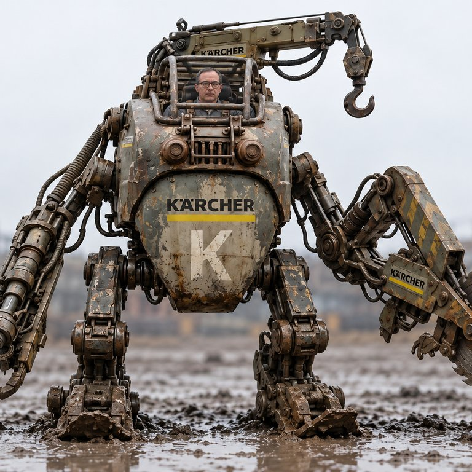
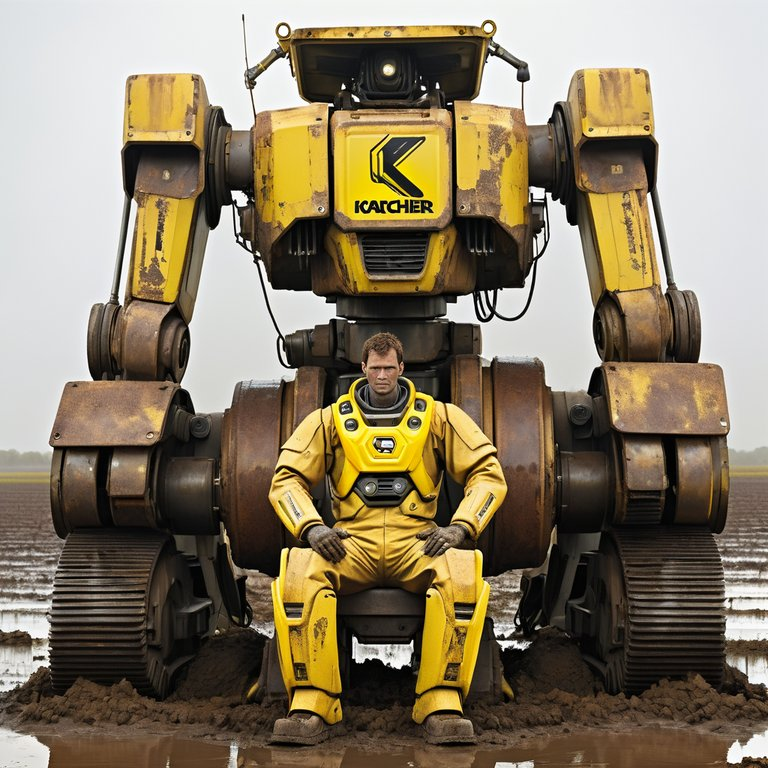
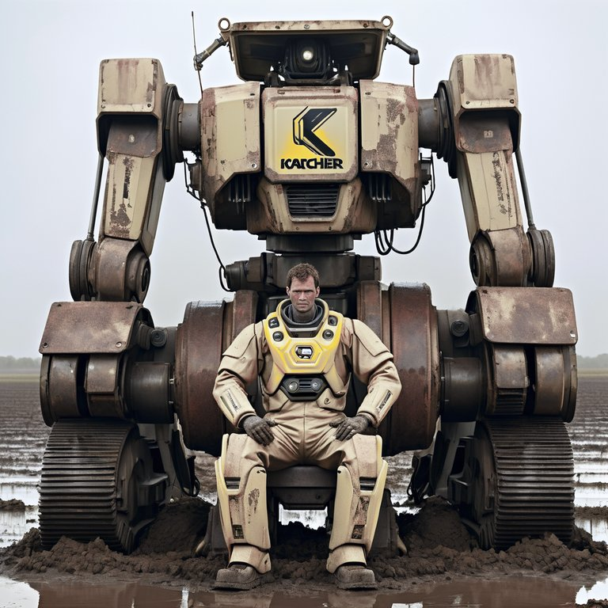
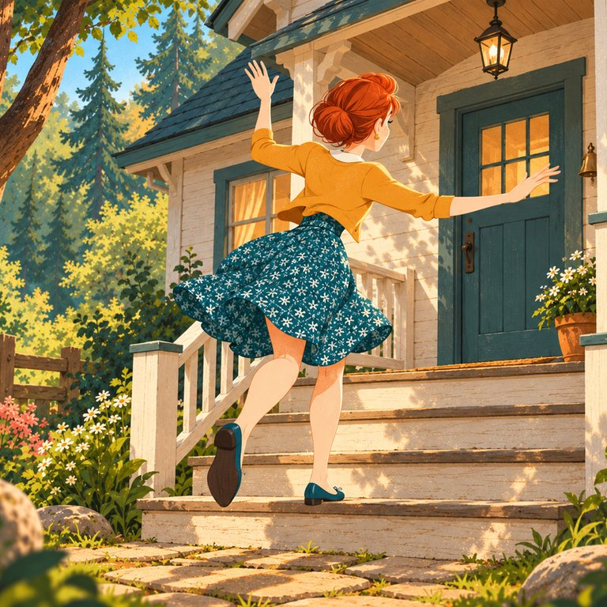
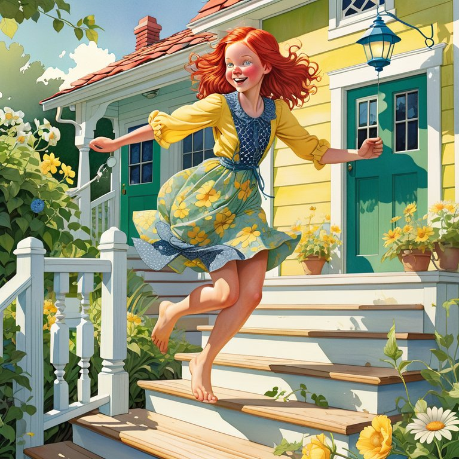
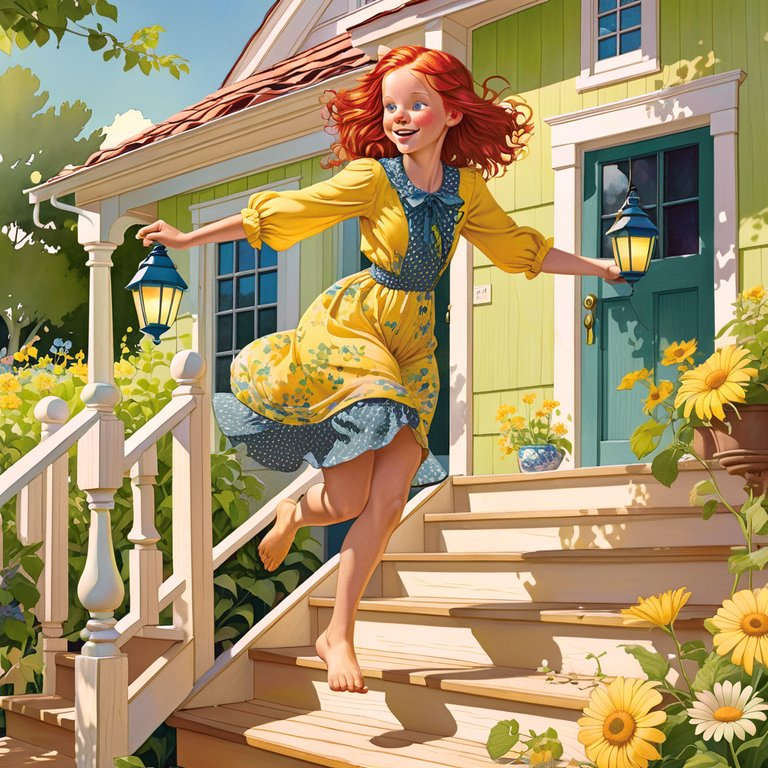

# A1111 Color Correction for ComfyUI

Keep a render's colours where you put them.

Any img2img, refine or upscale pass drifts in colour. The higher the denoise,
the further it goes: skies warm up, skin cools down, a grade you spent an hour
on comes back looking like someone else's. The Automatic1111 webui has had a
one-checkbox fix for this since 2022. This pack brings that fix to ComfyUI —
and then does the thing A1111 cannot: holds the colour *while the image is
being made* instead of repairing it afterwards.

**No models to download. No dependencies beyond what ComfyUI already installs.**

---

## What it looks like

Three rows from the **[showcase](docs/showcase/README.md)** — every node on pictures, with its settings and the
measured numbers (SDXL, 30 October 2026).

| img2img at denoise 0.9 | Input | No correction | A1111 Color Correction |
|---|---|---|---|
| bit-identical to the webui's own function |  |  |  |

| A dusk street, Teal and orange | No grade | Wheels on the decoded picture | Grade wheels — latent |
|---|---|---|---|
| the model composes in the look; 2.8° of hue from the image grade |  |  |  |

| Loopback, 8th pass | Input | No correction | Colour correction |
|---|---|---|---|
| colour drift 7.7 without, 0.7 with |  |  |  |

---

## What it does

### The blend decides whether the cast is removed at all


`A1111 Color Correction` is the faithful port of
`modules/processing.py: apply_color_correction`: histogram-match the result to
the reference in LAB, then blend so the generated image **keeps its own
brightness and takes only the reference's colour**.

That last clause is the whole operation, and it is easy to get backwards. The
third and fourth panels above are the *same* histogram match, blended the two
possible ways — 2.6 against 3.4 in distance from the reference. One removes
the cast, the other keeps most of it.

This matters here because the first version of these nodes had it backwards by
default. Over random image pairs the two blends differ by an average of
**78.6 / 255**. The old behaviour is still available as `lab_luminosity`,
honestly labelled.

### The whole strength range is useful


### The colour is held during sampling, not patched afterwards


`Apply Latent Color Guidance` patches the `MODEL`. At every step the model
predicts what it thinks the finished image looks like; the patch nudges that
prediction towards your reference's palette and hands it back. The model then
keeps working *in* the corrected palette rather than being dragged into it at
the end — so the image is composed in the right colours, including the parts a
post-hoc filter can never reach, like what the model decides to put in the
shadows.

Because it patches the model instead of replacing the sampler, **every sampler
works**: KSampler, KSamplerAdvanced, SamplerCustom, detailers, anything
downstream.

| SDXL, img2img at denoise 0.72 | Distance from reference | Detail energy |
|---|---|---|
| no guidance | 5.59 | 6.46 |
| guidance, strength 0.4 | 3.93 (−29.7%) | 6.44 |
| guidance, strength 0.7 | **2.99** (−46.5%) | 6.52 (+0.9%) |

Detail energy barely moves, which is the point of correcting in the colour
subspace rather than across every channel.

Measured on the latent directly, without the VAE round trip in the way, the
correction removes **100%** of a deliberate cast (projected colour error
0.1767 → 0.0000).

### The same controls on every model family

SD1.5 and SDXL have 4-channel latents whose channels behave roughly like
colour axes. SD3 and Flux have 16, Wan 2.2 has 48, Flux.2 and LTX-Video have
128 — and there, only a few directions carry colour while the rest carry
structure and texture. Matching all of them per channel changes *how much
detail the image has*, which is not what anyone asks a colour node for.

So the correction is not done in raw channels. ComfyUI ships a latent-to-RGB
matrix for 42 of its 45 latent formats — the one it uses to draw sampling
previews. Projecting through it gives one algorithm for every model:

```
rgb   = Pᵀ·l + b                   project the latent into approximate RGB
rgb'  = f(rgb)                     do the colour transfer there, in 3 channels
Δl    = P(PᵀP)⁻¹·(rgb' − rgb)      minimum-norm step back into the latent
```

The pseudo-inverse is the point. Three equations, C unknowns: the minimum-norm
solution puts the entire correction inside `span(P)` — the three directions
that carry colour — and leaves the other C−3, which hold structure and
texture, untouched by construction.

Verified exactly (`Pᵀ·Δl == Δrgb` to 1e-6) for 4-, 16- and 48-channel latents,
and the 128↔32 channel repacking Flux.2 needs round-trips bit-for-bit.

**What that does and does not promise.** The same controls work everywhere,
and a wheel pushed towards red warms the picture on every family. The exact
hue and the exact strength do not carry across, because `P` is a least-squares
fit to a decoder that is not linear — it is the same approximation that makes
ComfyUI's sampling previews look washed out. Saturated colours are where it is
furthest off. So treat the latent node as *approximate colour, applied while
the image is made*, and reach for the image node when the number matters.

Three of the 45 latent formats ship no matrix at all (SeedVR2, CogVideoX,
HunyuanImage 2.1 Refiner). On those the node says so in the log and leaves the
model alone rather than pretending.

### Three transfer methods, for three different problems


- **`mean_only`** shifts each channel's average. It cannot change contrast or
  detail, so it is the safe default on many-channel latents.
- **`reinhard`** matches average *and* spread — the classic transfer. Use it
  when the render has lost contrast as well as colour.
- **`mkl`** is optimal linear transport (Monge–Kantorovich). It accounts for
  correlations *between* channels, so a cast lying diagonally across them is
  removed rather than approximated axis by axis.

On SDXL at strength 0.6 the three land close together on the average (3.23 /
3.28 / 3.20) and separate on the spread, where MKL is clearly ahead: 0.91
against 1.12 for `mean_only` and 1.55 for `reinhard`.


One honest note on `space`. On a four-channel SD or SDXL latent the channels
really do behave like colour axes, so matching them raw is competitive — it
reaches 2.75 against the projection's 3.28. It also pushes detail energy to
7.76 against 6.50, because a per-channel gain above one amplifies fine detail
along with the colour. The projection is the conservative choice there, and
the necessary one on the many-channel families, where raw matching would be
rescaling structure and texture rather than colour.

### The thing people remember as "built into sampling"

A1111 has **no colour correction inside its sampler**. Reading
`sd_samplers_cfg_denoiser.py`, `sd_samplers_kdiffusion.py` and
`sd_samplers_common.py` turns up no correction on any step; the only per-step
operation touching the latent is the inpaint mask blend.

What people remember is `scripts/loopback.py`, and **A1111 Loopback**
reproduces it: a chain of img2img passes where each output becomes the next
input, and every pass is corrected against one reference measured once from
the starting image. Because each pass is a full img2img at 0.75 → 0.5 denoise,
the *content* is reworked every time — which is exactly why it felt like more
than a colour filter — while the anchor never moves, so the palette cannot
drift however long the chain runs.

Testing it turned up a property of A1111's algorithm worth knowing about: its
blend takes lightness from the generated image, so a chain holds **colour**
perfectly flat and lets **exposure** drift uncorrected. Over ten passes on a
synthetic cast, chroma error stayed at 0.16 while lightness went to 28. The
node adds an optional `hold_exposure` for that, clearly marked as going beyond
A1111 — it matches lightness by average and spread rather than by its whole
histogram, so deliberate changes in lighting survive.

---

## The nodes

| Node | Takes | Gives | For |
|---|---|---|---|
| **Apply Latent Color Guidance** | `MODEL`, `LATENT` | `MODEL` | Holding a palette through sampling. The main one. |
| **A1111 Color Correction** | `IMAGE`, `IMAGE` | `IMAGE` | The faithful A1111 post-pass on a decoded image. |
| **A1111 Loopback** | `MODEL`, `VAE`, `IMAGE` | `IMAGE` | A chain of img2img passes anchored to one reference. |
| **Latent Color Match** | `LATENT`, `LATENT` | `LATENT` | One-shot match, before or after sampling. |
| **KSampler (A1111 Latent Color Match)** | — | — | Deprecated. Kept so old workflows still open. |

Where each one is exact, and where it is not:

| | Exact | Approximate |
|---|---|---|
| **A1111 Color Correction** | always — bit-identical to the webui's own function on its pinned libraries (numpy 1.26.2, OpenCV 4.8.1, scikit-image 0.21.0, blendmodes 2022): 0 of 255 on four img2img pairs | — |
| **Grade wheels — image** | always | — |
| **Apply LUT** | the table, as written | — |
| **Loopback** | the correction between passes | — |
| **Latent Color Match**, **Guidance**, **Grade — latent** | the direction of the change | the exact hue and strength, because the latent-to-RGB matrix is a linear fit to a decoder that is not |

The latent nodes earn their place by changing what the model draws rather
than what comes out of it. When the precise number matters, finish on an
image node.

**Grade — latent on SDXL** writes its colour through the decoder's *measured*
axes (`a1111_cc/axes.py`, made with `tools/calibrate_axes.py`), not through the
preview matrix: inverted, the preview fit turned warm highlights magenta at
three to six times the asked strength. It holds the levels of the first
prediction in its window, so it also resists what the model repaints after
that; the window therefore starts at 0.6 by default (from 0.3 a denoise-0.7
img2img came out 3.4 times the grade). Measured on SDXL with dpmpp_2m against
the same wheels applied afterwards: a dusk street (txt2img) within 3° at 0.90
of the size at strength 1.0, and 0.78 / 0.76 of the share at 0.5 / 0.25; a
bright img2img at denoise 0.7 within 3° at 1.1 / 0.67 of the size at 1.0 / 0.5.
SD3 / SD3.5 has measured axes too (a txt2img street: 10.9° and 0.90 of the
size, where the preview matrix gave 24.5° and 0.82). SD1.5 was checked with
the preview matrix and needs none (2.1°, 0.93). Other families use the
preview matrix until they are measured.

All of them take an optional `MASK`, which restricts *where the colours are
measured* — the usual want for inpainting, where the surrounding plate would
otherwise drag the statistics towards doing nothing.

---

## Install

**ComfyUI Manager** — search for "A1111 Color Correction".

**Manually:**

```bash
cd ComfyUI/custom_nodes
git clone https://github.com/YOUR_GITHUB_USERNAME/ComfyUI-A1111-ColorCorrection
```

Nothing to install afterwards. OpenCV is used automatically when present,
because A1111 runs on it and that makes the LAB conversion bit-identical;
without it the numpy path lands within 3/255 of the same place.

---

## Quick start

Three workflows are in [`examples/`](examples) — drag any into ComfyUI:

1. **`01_img2img_color_correction.json`** — the post-pass, with a before/after
   preview so you can see what it did.
2. **`02_latent_color_guidance.json`** — the model patch. Bypass it with
   Ctrl+B to compare.
3. **`03_guidance_plus_correction.json`** — both stages, the usual production
   setup for an upscale or refine pass.
4. **`04_a1111_loopback.json`** — the Loopback chain, with every pass
   previewed so you can watch the content change while the palette does not.

| Setting | Start at | Why |
|---|---|---|
| `strength` | 0.5–0.7 | Above that the model fights the correction instead of following it. |
| `start_percent` | 0.15 | Before that the prediction is still featureless and its spread means nothing. |
| `end_percent` | 0.9 | Leaving the last steps alone lets detail settle undisturbed. |
| `method` | `auto` | `reinhard` for 4-channel latents, `mean_only` where channels are not colour axes. |
| `space` | `auto` | The RGB projection — the same controls on every family, approximate in the exact hue. |

---

## Measured results

"Distance" is the mean absolute difference between a result's LAB channel
statistics and the reference's, in 0–255 levels: lower is closer to the
colours you asked for.

**Image node, deliberate red/blue cast** (SD 1.5, 512):

| | Distance | |
|---|---|---|
| the cast | 12.35 | |
| corrected | **1.63** | 86.8% removed |

Brightness moves by 0.00097 — the A1111 blend keeps the original's luma, as it
should.

**Blend and strength** (SDXL, 1024, the figures above):

| strength | 0 | 0.35 | 0.7 | 1.0 |
|---|---|---|---|---|
| distance | 5.6 | 4.6 | 3.5 | **2.6** |

The inverted blend at full strength reaches only 3.4.

**Loopback chain** (SD 1.5, 512, three passes at denoise 0.65 → 0.45, drift
from the starting image):

| | Lightness | Chroma |
|---|---|---|
| no correction | 5.93 | 4.77 |
| A1111's correction | 5.51 | **0.13** |
| plus `hold_exposure` | **0.04** | 0.17 |

The middle row is the shape of A1111's algorithm, not a shortcoming of the
port: colour is pinned, exposure is left alone. Over a ten-pass synthetic
chain chroma error stays flat — 0.08 after two passes, 0.16 after ten — while
lightness climbs with every pass unless `hold_exposure` is raised.

### Every sampler, not most of them

The original node modified the sampler's working tensor in place from a
callback — which several samplers simply discard, so it silently did nothing
for them. The patch hooks the noise prediction instead. Calls counted over a
six-step run:

| Sampler | Calls | Sampler | Calls |
|---|---|---|---|
| euler | 6 | ddim | 6 |
| euler_ancestral | 6 | uni_pc | 6 |
| heun | 11 | lcm | 6 |
| dpm_2 | 11 | dpm_adaptive | 57 |
| dpmpp_2m | 6 | res_multistep | 6 |
| dpmpp_sde | 11 | | |

Samplers that evaluate the model twice per step correct twice per step, so
`strength` is per model call rather than per step. `dpm_adaptive` chooses its
own step count.

### Tests

68 unit tests, needing only numpy and torch:

```bash
python tests/test_color.py          # image maths, incl. A1111 parity   (14)
python tests/test_latent_core.py    # statistics, transfers, projection (30)
python tests/test_loopback.py       # the chain, with sampler and VAE stubbed (24)
python tests/test_examples.py       # the example workflows stay loadable (--server HOST:PORT also checks node types)
python tests/test_package.py        # the package compiles, imports, keeps its keys (5)
```

`test_package.py` exists because `__init__.py` imports each node module inside a
try/except so one broken node cannot hide the rest — which also means a syntax
error leaves the pack importable, just short of those nodes. It imports them
directly, and it pins the registry keys: the display names carry the `ColorKit`
prefix for searchability, but the keys a saved workflow stores never change.

The integration suite drives real checkpoints inside ComfyUI and reports VRAM
and RAM at every boundary, so a run says what it costs and proves the models
were unloaded again:

```bash
python tests/test_integration_comfy.py --comfy /path/to/ComfyUI \
    --sd15 /path/to/checkpoint.safetensors --image reference.png
```

That integration suite imports ComfyUI as a library, which is the one place in
this repository that still does. It is deliberate — it measures VRAM at each
boundary — but be aware of what library mode costs: outside `execution.py`'s
`torch.inference_mode()` the VAE's parameters keep `requires_grad=True`, so
every encode and decode retains an autograd graph, several gigabytes of it at
1024².

The demonstration figures are regenerated by `tools/make_demos.py` and
`tools/make_showcase.py`, which for that reason do **not** load a model at all.
They queue their work to a ComfyUI you already have running, so the server's
own memory management, progress and Interrupt button apply; the figures that
need no model are computed in the script, on the CPU.

```bash
# start ComfyUI the usual way first, then:
python tools/make_demos.py --image reference.png --sdxl <checkpoint> --dry-run
python tools/make_demos.py --image reference.png --sdxl <checkpoint>
```

`--dry-run` builds every graph and checks each class and input name against the
server's `/object_info` without queueing anything, so a typo surfaces in seconds
rather than after twenty minutes of sampling. `--gap` sets the pause between
generations, `--server` the address, `--unload` frees the models at the end.

---

## What changed from the original nodes

These began as two private nodes. Both had bugs worth naming, since you may
have workflows built on them.

**The blend was inverted** — see above. 78.6/255 of difference, by default.

**The reference latent was in the wrong scale.** The sampler works on latents
multiplied by the format's `scale_factor`, but a `LATENT` socket carries the
unscaled value — measured at 0.18215 for SD1.5, so a factor of 5.5 out, and
7.7 for SDXL. That is why the old node's strength defaulted to `0.01` and fell
apart at any sane value.

**Statistics came from the noisy latent.** Since `std(x)² = std(x₀)² + σ²`,
early in sampling that measurement is mostly noise. The correction now works
on the model's clean prediction, where the colour actually is.

Also fixed: `noise_mask` was ignored, so the node stopped being an inpaint
sampler; latent previews were lost; an even blur radius silently did nothing;
`requirements.txt` was cp1251-encoded, which makes pip fail on Linux and would
have blocked ComfyUI-Manager installs entirely.

### Migrating

`KSampler (A1111 Latent Color Match)` still loads and still samples. It is
marked deprecated and hidden from the menu, with the same inputs in the same
order, so saved graphs open unchanged. **Its strength now means something
different**: it corrects a correctly-scaled reference, so start around 0.3–0.5
rather than 0.01. The step ratios are now read as a share of the model's sigma
schedule rather than of the step count, which shifts the window slightly on
non-linear schedulers such as karras.

---

## Resolutions and model support

These nodes impose no resolution rule of their own, and the reference does not
have to match the size of what you are sampling — only its colour statistics
are read, so a 512×512 reference can steer a 1536×1536 upscale. It does have
to come from the same VAE. Per-family constraints are in
[`docs/model-support.md`](docs/model-support.md).

---

## Credits

The image pipeline reproduces `apply_color_correction` from
[AUTOMATIC1111/stable-diffusion-webui](https://github.com/AUTOMATIC1111/stable-diffusion-webui),
including a numpy port of the `blendmodes` luminosity blend it relies on.

MIT licensed — see [LICENSE](LICENSE).
