# What ColorKit does, on pictures

Everything below was rendered on 30 October 2026 through a running ComfyUI (ProtoVision XL, SDXL, unless a section
says otherwise) and measured with OpenCV LAB means: the numbers are distances between colour averages, 0–255.
Click a picture for full size. The two test pictures — a mech robot (photo style) and a girl on a porch
(illustration) — are the author's own; film frames are open-licensed, see [CREDITS](CREDITS.md).

## The interface

ColorKit's nodes in the ComfyUI editor (frontend 1.55), as you get them — screenshots at 1:1.

**Grade wheels.** Lift, gamma and gain as three colour wheels, each with a master slider and its numbers underneath;
saturation and contrast below. Drag a wheel, Shift for fine moves, Alt-click to reset. Here the *Teal and orange* preset:
lift pushed to teal, gain to orange.

**Presets, one right-click away.** 15 built-in looks, plus your own: *Save these settings as a preset…* stores the current
wheels by name, *Delete a preset* removes one. *Show the numbers* opens every value as a slider.

| Right-click → Presets | Show the numbers |
|---|---|
|  |  |

**A whole workflow.** Template 05: a picture in, the wheels, before and after — no model needed, it runs in a fraction of
a second.

**Grading while the image is made.** Template 06: the latent wheels patch the model (top), the same seed renders ungraded
below, and the image wheels grade that render afterwards — so both ways can be compared side by side (section 6).

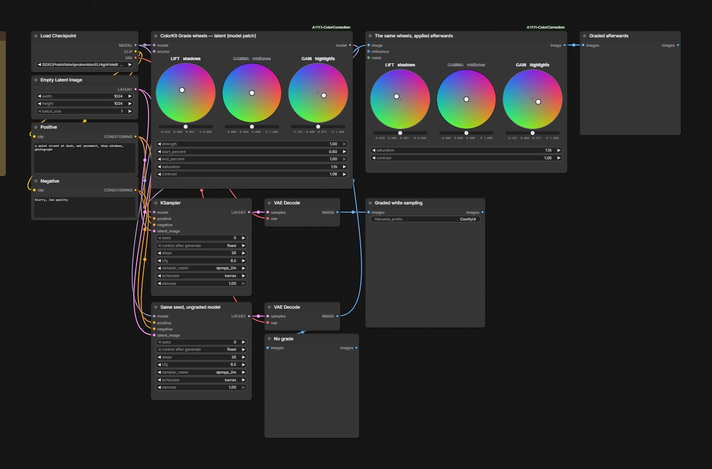

**Scopes and compare** draw their own images: vectorscope, RGB parade and histogram; a wipe, side by side, difference or
checkerboard of two pictures.

| ColorKit Scopes (the robot after Teal and orange) | ColorKit Compare, wipe |
|---|---|
|  |  |

## 1. img2img drifts in colour; A1111 Color Correction puts it back

The robot through img2img, prompt describing it, seed 0, dpmpp_2m / karras, 24 steps, cfg 7. Right column: the
**A1111 Color Correction** node (strength 1.0, blend `a1111`) with the input as reference.

| | Input | img2img, no correction | A1111 Color Correction |
|---|---|---|---|
| **denoise 0.5** | 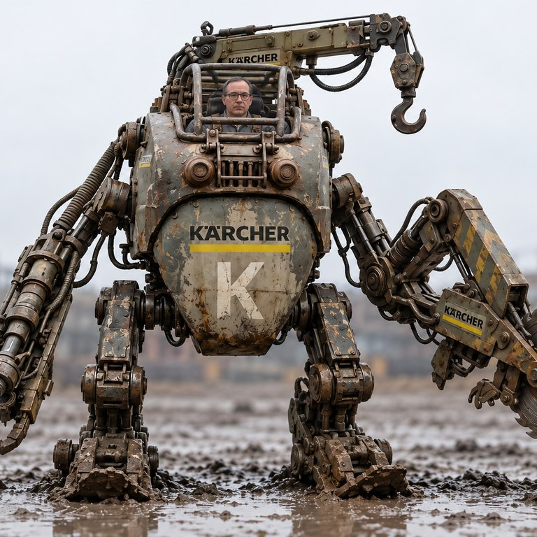 |  |  |
| **denoise 0.7** |  |  |  |
| **denoise 0.9** |  | 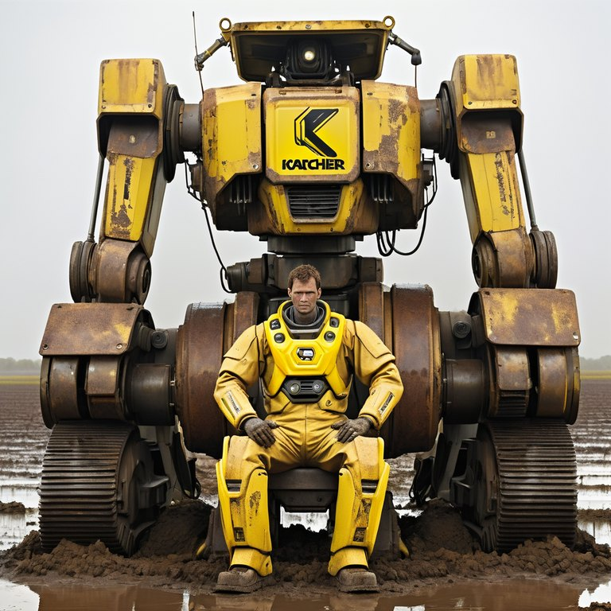 | 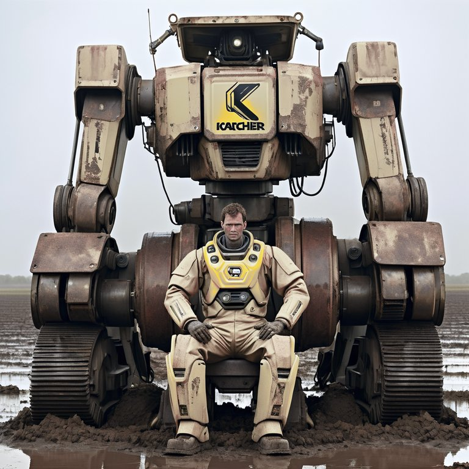 |

The node is **bit-identical** to the webui's own `apply_color_correction` on the libraries the webui pins (numpy
1.26.2, OpenCV 4.8.1, scikit-image 0.21.0, blendmodes 2022): max |Δ| 0 of 255 on four img2img pairs. Like the webui
it keeps the generated brightness and takes only the reference's colour.

## 2. Latent Color Guidance holds the colour while the picture is made

Same seed and settings; **Latent Color Guidance** at strength 0.6, window 0.15–0.9 of the schedule, the input's latent
as reference.

| | Input | img2img, no guidance | Latent Color Guidance |
|---|---|---|---|
| **denoise 0.5** |  |  |  |
| **denoise 0.7** |  |  |  |
| **denoise 0.9** |  |  |  |

Strength is monotonic: LAB distance to the input 3.11 without, 2.02 / 1.78 / 1.34 at 0.4 / 0.6 / 0.8 (denoise 0.7).
At denoise 0.3 it does nothing — the run starts below the window's lower edge — and the node says so in the console;
use the image node for such light passes.

## 3. The same on an illustration, two seeds

| | img2img, nothing | A1111 Color Correction | Latent Color Guidance |
|---|---|---|---|
| **denoise 0.7 · seed 0** | 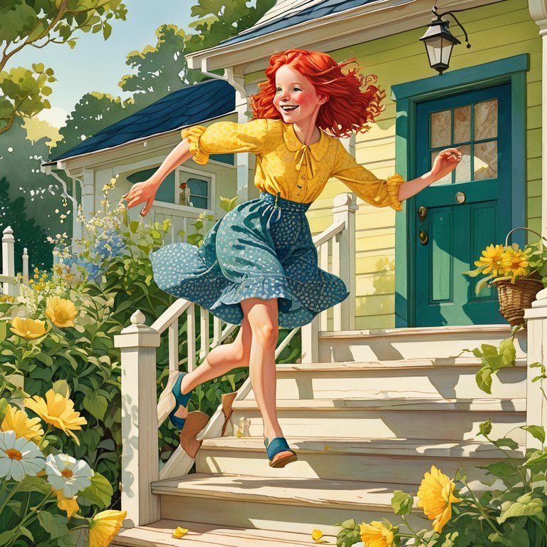 |  | 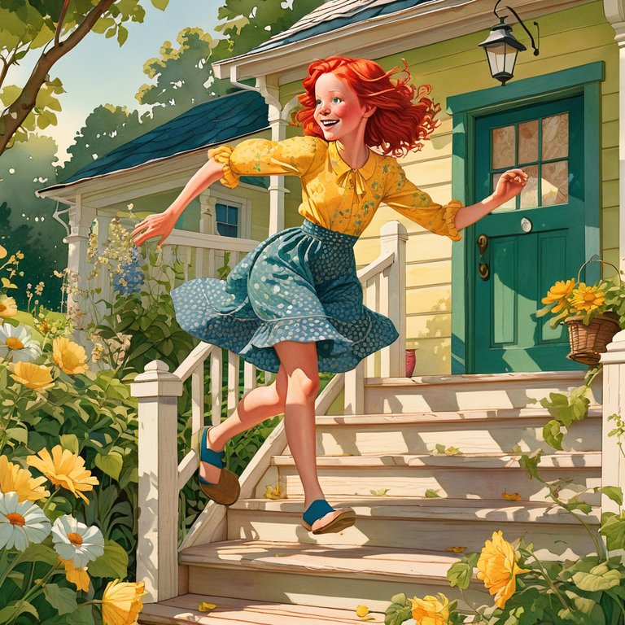 |
| **denoise 0.7 · seed 1** |  | 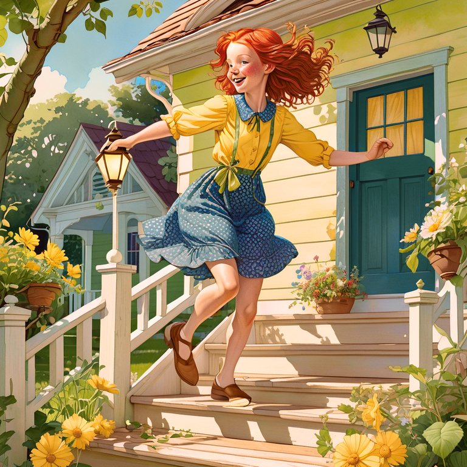 | 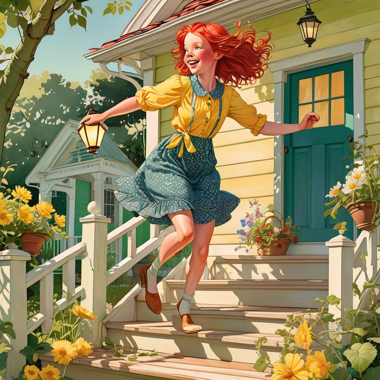 |

Input: the girl, prompt describing her. Colour distance to the input, denoise 0.7: 5.56 / 4.89 without, 0.68 / 0.98 with
the correction (seeds 0 / 1); guidance 5.65 → 2.24 and 7.03 → 3.27, detail within 3 %.

## 4. Loopback: eight img2img passes

**A1111 Loopback**, denoise 0.75 → 0.5 linear, seed +1 per pass. Colour correction takes its colour from the first
frame, as in the webui; `hold_exposure` is ColorKit's own addition and holds brightness too.

| | No correction | Colour correction (as A1111) | Correction + hold_exposure 0.7 |
|---|---|---|---|
| **pass 1** |  |  |  |
| **pass 4** |  |  |  |
| **pass 8** | 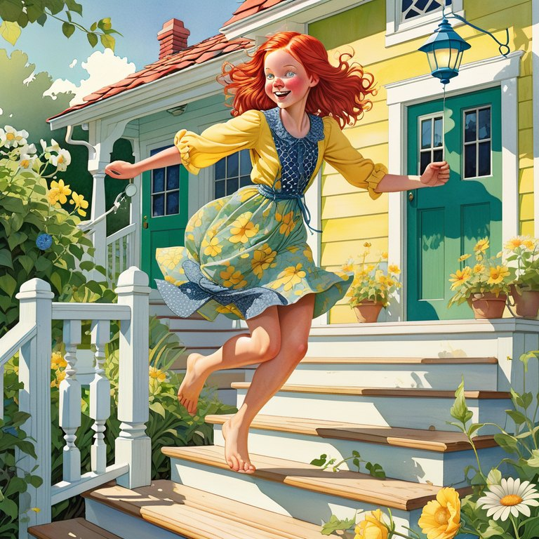 | 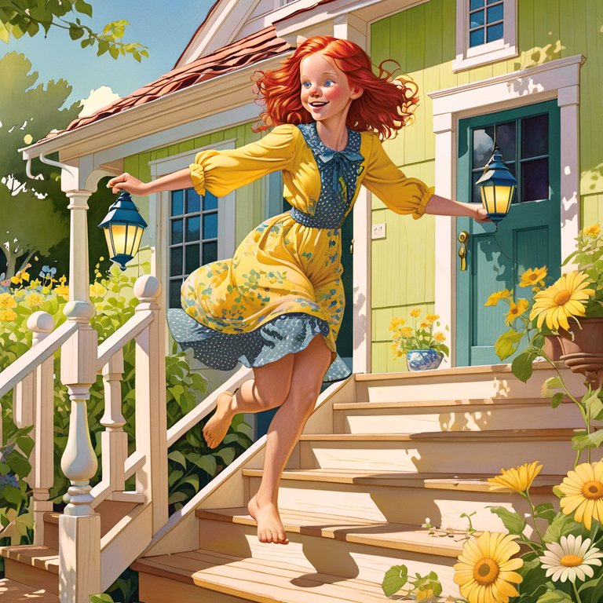 |  |

Colour distance to the input over the 8 passes: 6.1–7.7 without correction, 0.3–1.3 with it. Brightness drifts
+11 → +19 L with or without the correction (the webui behaves the same); with `hold_exposure` 0.7 it stays within
+2.4…+3.7 — exactly 30 % of the drift, as the setting says.

## 5. Grade wheels and presets

**Grade wheels — image**: lift / gamma / gain wheels, saturation and contrast, on a finished picture. Six of the 15
built-in presets:

| | Robot | Girl |
|---|---|---|
| **input** |  | 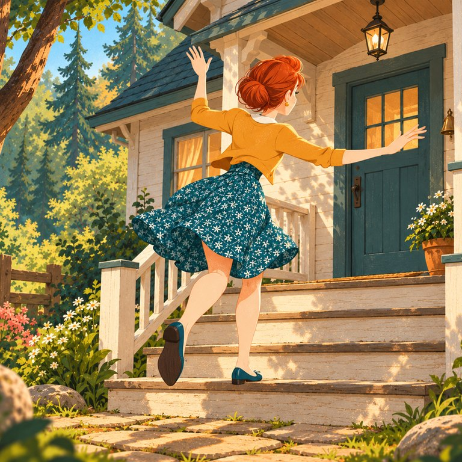 |
| **Teal and orange** |  |  |
| **Golden hour** |  |  |
| **Moonlight** |  |  |
| **Bleach bypass** |  |  |
| **Two strip** |  |  |
| **Day for night** |  |  |

Each preset ships as a `.cube` LUT too: preset and LUT of the same name differ by at most 0.5 of 255 on average.
**Save Grade as LUT** round-trips through a 33³ cube within 3 of 255 (mean 0.06).

## 6. Grading while the image is made

**Grade wheels — latent** applies the same wheels to the model's prediction, so the model composes in the look rather
than having it laid over afterwards. A dusk street from scratch (seed 0, 26 steps, cfg 6.5), Teal and orange:

| | No grade | Same wheels on the decoded picture | Grade wheels — latent |
|---|---|---|---|
| **SDXL** | 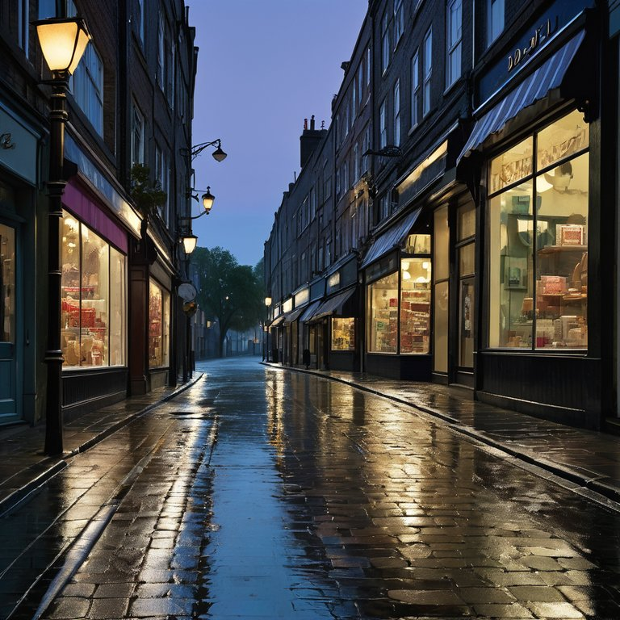 | 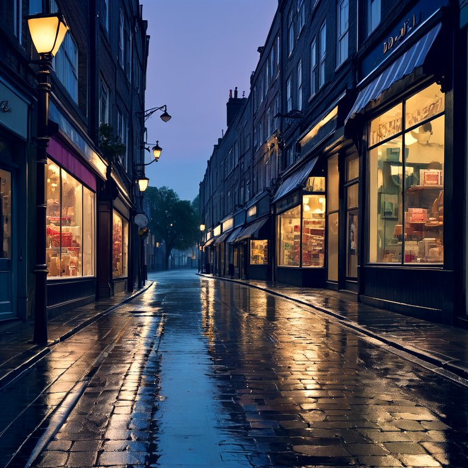 |  |
| **SD3.5 medium** |  |  |  |

| | strength 0.25 | strength 0.5 | strength 1.0 |
|---|---|---|---|
| **SDXL** |  | 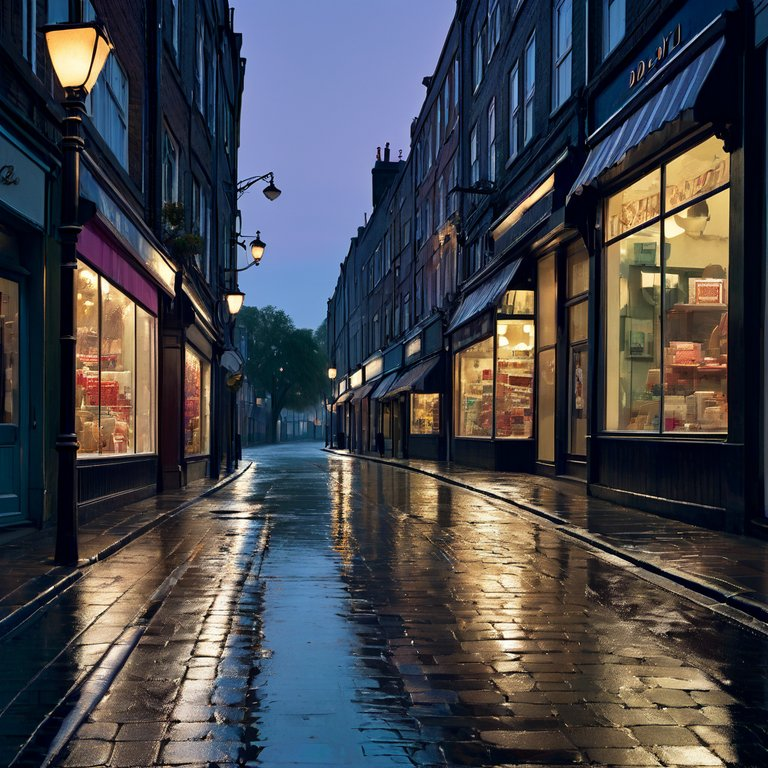 |  |

Against the same wheels applied afterwards: SDXL within 2.8° of hue at 0.90 of the size, SD3.5 within 10.9° at 0.90;
strength 0.25 / 0.5 / 1.0 gives 0.19 / 0.39 / 0.90 of it. The colour is written through the decoder's measured axes
(SDXL, SD3); the preview matrix turned warm highlights magenta at three to six times the strength.

## 7. Colour from a film frame

Every latent node takes a reference. The robot, img2img denoise 0.7, coloured from three film frames:

| | Film frame | Latent Color Guidance | Match + Guidance + Correction |
|---|---|---|---|
| **Tears of Steel** |  | 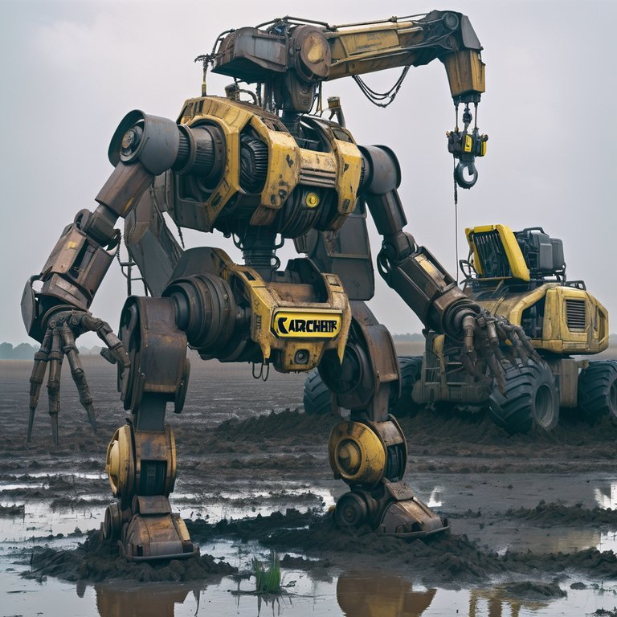 | 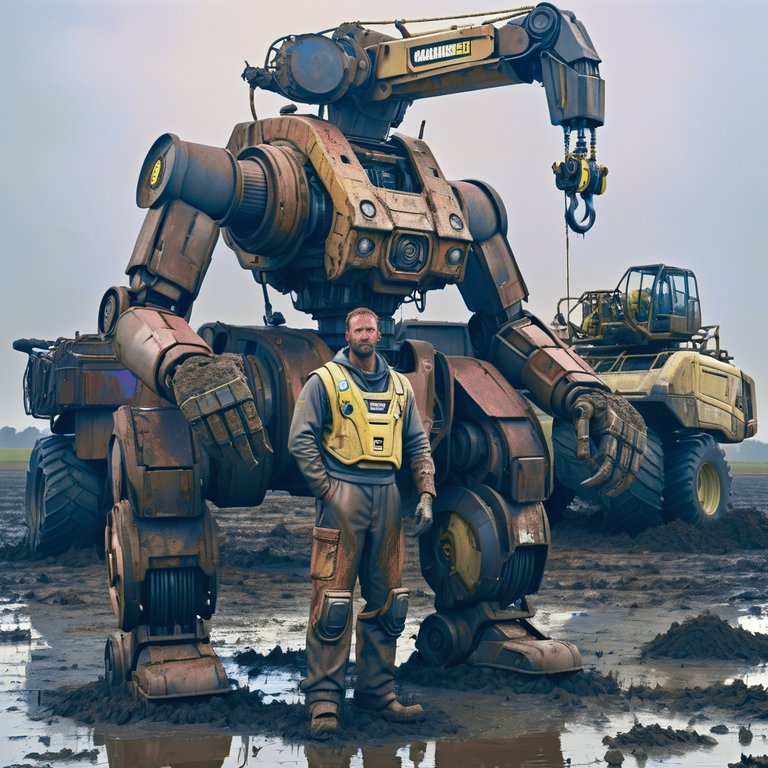 |
| **Sintel** |  | 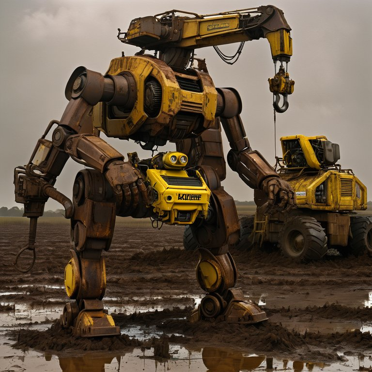 | 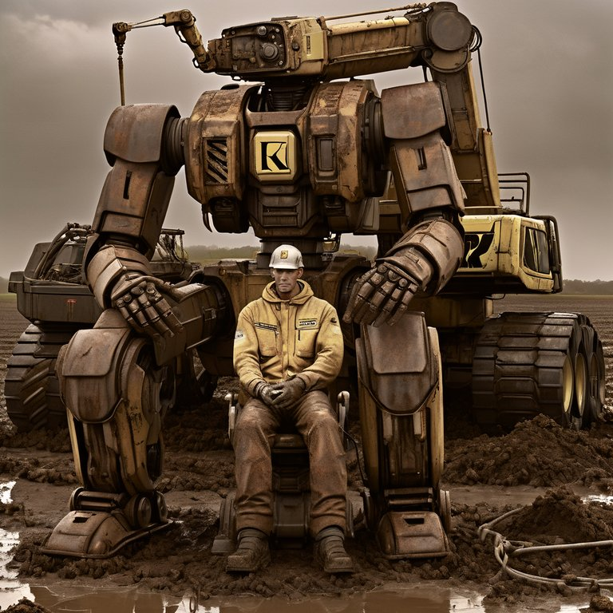 |
| **Spring** |  | 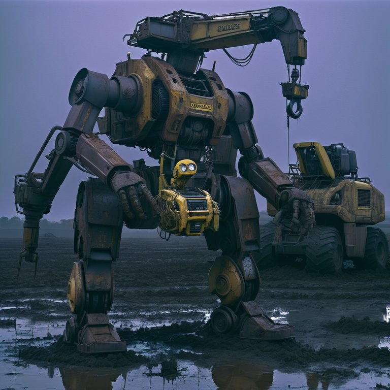 | 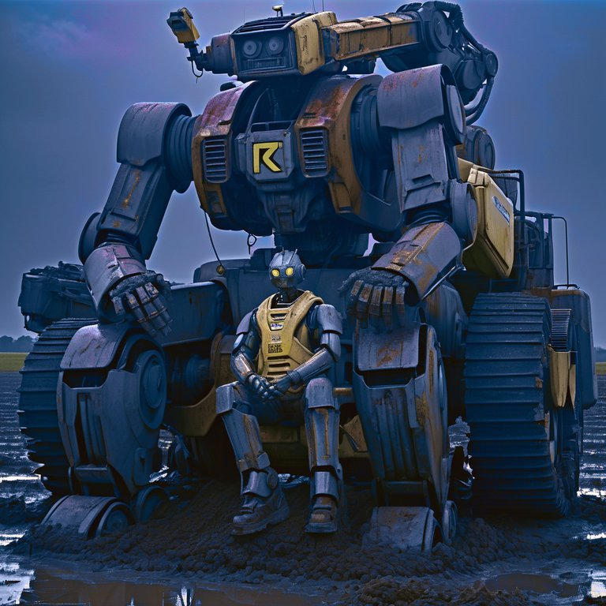 |

Share of the way to the frame's colour (1 = there): guidance 0.34–0.69, the three nodes together 0.69–0.95, the
latent wheels with the frame as `anchor` 0.70–0.94. The full chain also changes what the model draws (a man appears,
the robot sits down) — it starts from a latent already pushed towards the frame.

## 8. IP-Adapter + colour held

Template 07: IP-Adapter PLUS (weight 0.8) for style, Latent Color Guidance (0.6) for the palette, one seed.

| | Film frame | IP-Adapter only | IP-Adapter + Latent Color Guidance |
|---|---|---|---|
| **Tears of Steel** |  |  |  |
| **Sintel** |  |  |  |

IP-Adapter already carries most of the palette; the guidance brings the colour 17 % closer to the frame on average
(×0.77–0.91 over five cases), detail within 4 %.

## 9. Masks

| | Mask (red: sky) | Correction everywhere | Correction inside the mask |
|---|---|---|---|
| **A1111 Color Correction** |  |  |  |

Outside a mask the image nodes change no pixel (max |Δ| 0). Inside, the correction measures its histograms there.

## 10. Other model families

| | Input | img2img, no guidance | Latent Color Guidance |
|---|---|---|---|
| **SD 1.5 (512²)** |  |  |  |
| **SD 3.5 medium** |  |  |  |

LAB distance to the input at denoise 0.7: SD 1.5 3.62 → 1.12, SD 3.5 1.48 → 0.68, detail within 3 %.
